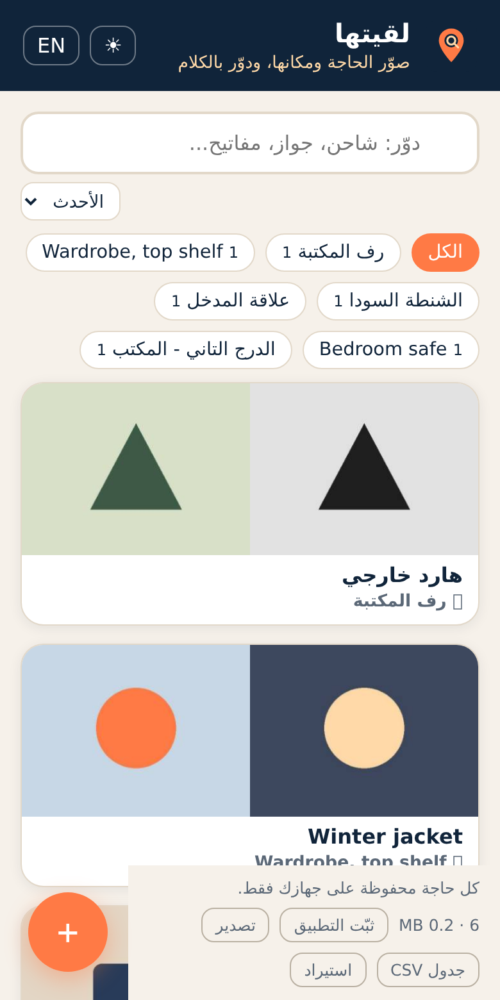
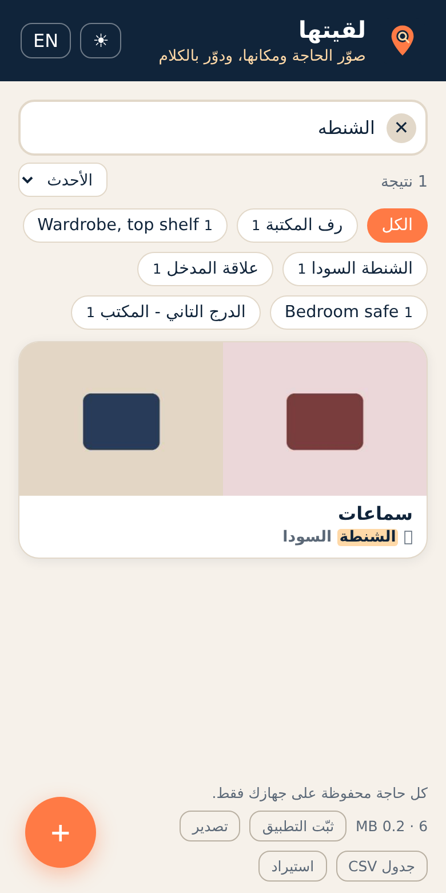
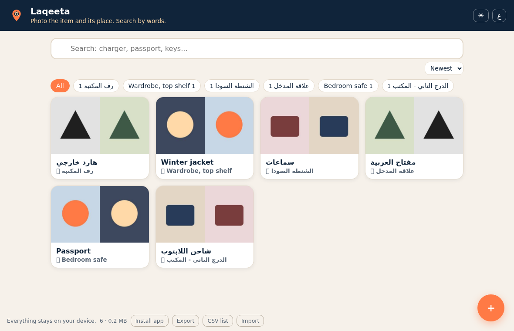

# Laqeeta | لقيتها

**Photograph an item and the place you put it. Search later by words.** Private, offline, free. Arabic and English.

**Live demo:** https://yousefkhames.github.io/laqeeta/

| Mobile (Arabic) | Mobile search | Desktop (English) |
|---|---|---|
|  |  |  |

Screenshots use generated sample images, not real photos.

## Why
"Where did I put the charger?" is a small problem that eats time. Laqeeta keeps one card per thing: a photo of the item, a photo of its spot, a name and a place. Typing a word you remember finds it.

## Features
- Two photos per item (item and its place), taken with the phone camera or picked from the gallery
- Instant ranked search over name, place and notes
- Arabic-aware matching: hamza, ya and ta marbuta variants, Arabic-Indic digits, leading "al-", one-letter typos
- Place chips with item counts, rename a place for all its items
- Favorites, sort (newest, oldest, A-Z), `#tags` in notes that search when tapped
- Remembers where an item used to be
- Undo for delete, duplicate-name hint, save and add another
- Zoom photos, remove or replace a photo
- Export and import JSON backup (with photos), CSV list, dated backup file names, backup reminder
- Shareable search links (`#q=word`), keyboard shortcuts (`/` search, `n` new)
- Arabic RTL and English LTR, automatic or manual light and dark theme
- Installable PWA that works offline
- Accessible: keyboard use, labels, focus ring, reduced motion

## Privacy
No server, no account, no analytics, no network calls. Everything lives in your browser (IndexedDB). Sharing an item only shares its name and place as text, and only when you tap share.

## Tech stack
Plain HTML, CSS and JavaScript. No framework and no build step. IndexedDB for storage, canvas for photo resizing and thumbnails, a service worker for offline use.

## Run it
```
git clone https://github.com/yousefkhames/laqeeta
cd laqeeta/docs
python3 -m http.server 8000
```
Open http://localhost:8000. The site is served from `docs/` by GitHub Pages.

## Tested
Scripted click-through in headless Chrome (add with photos, save, typo and place search, highlight, view, favorite, delete and undo, language switch) at desktop and mobile sizes in Arabic and English, with no console errors. Not yet tested on a real phone camera or iOS Safari.

## Honest limits
- Data stays in one browser on one device. Use Export to move or back it up. Clearing site data deletes items.
- No AI auto-tagging or photo recognition. Search is over the words you type.
- Photos are resized (about 900 px) to keep storage small.

## License
MIT, see [LICENSE](LICENSE).
